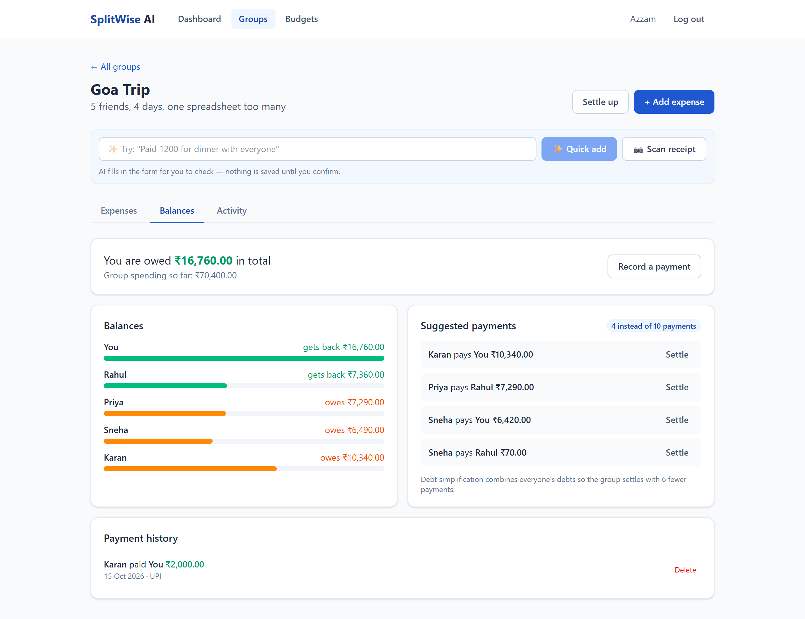
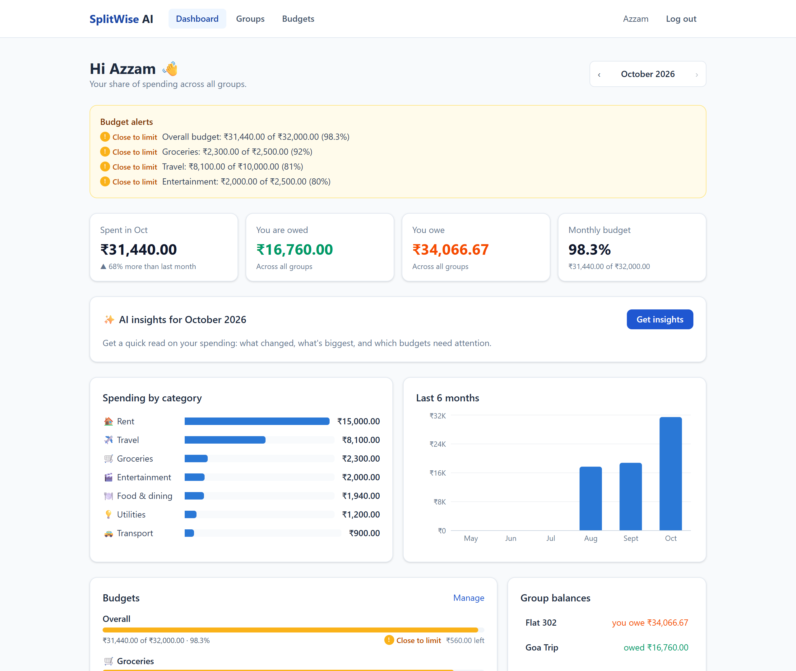
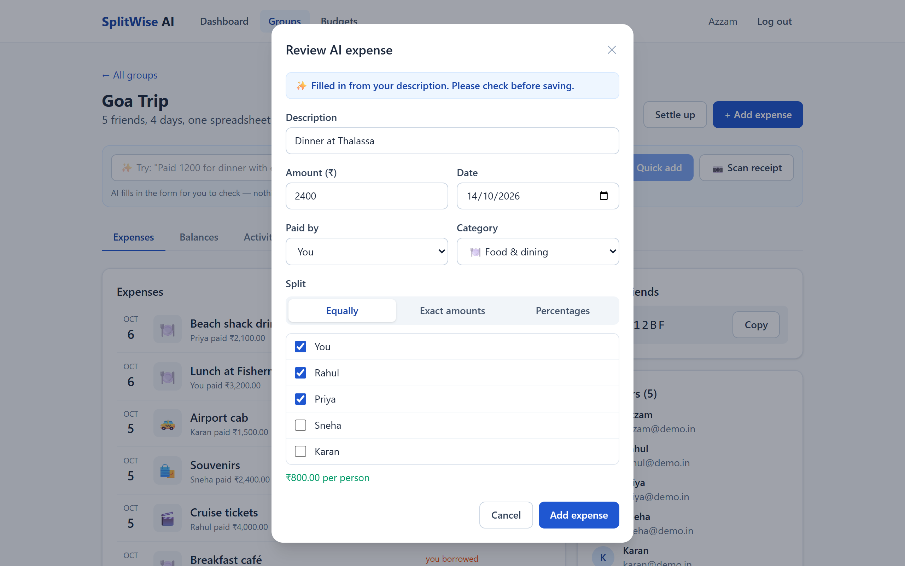
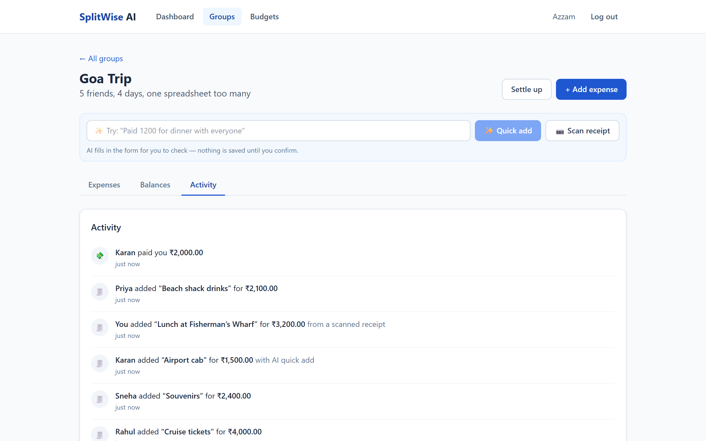
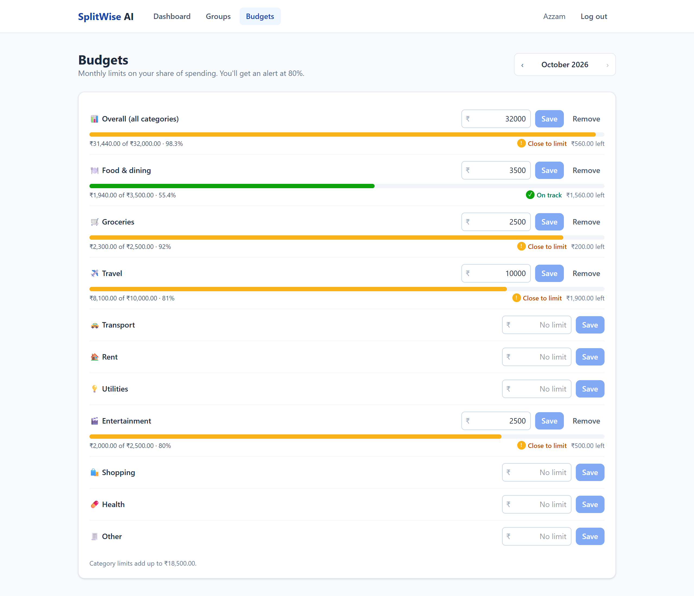
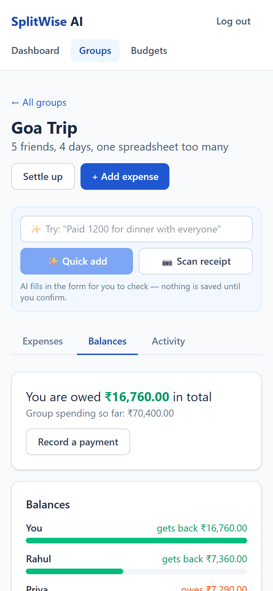
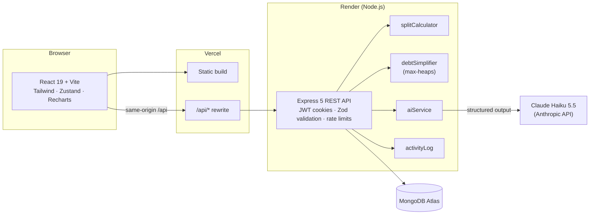

# SplitWise AI

**Split group expenses, settle up in the fewest payments, and stay on budget. Add expenses by typing a sentence or snapping a receipt.**

Built for **TCS Zeta Innovate** · MongoDB · Express · React · Node.js · Claude API



## The problem

Shared money gets messy fast. After a 4-day trip, five friends have 12 expenses, each paid by someone
different and split differently. Working out who owes whom by hand takes **10 separate payments**.
Logging every bill is tedious too, so people stop doing it and the group spreadsheet dies halfway
through the trip.

## The solution

| | |
|---|---|
| **Fewest payments to settle** | Debt simplification nets everyone's balances and matches the biggest debtors with the biggest creditors. The Goa trip above settles in **4 payments instead of 10**. |
| **Expenses in one sentence** | Type *"Paid 2400 for dinner at Thalassa with Rahul and Priya yesterday"*. AI fills in the amount, date, category, payer and split, and you confirm. |
| **Receipt scanning** | Snap a bill and the total, merchant, date and line items are read for you. |
| **Budgets that warn early** | Set monthly limits per category. The dashboard flags anything close to or over its limit. |
| **Activity feed** | Every add, edit, delete and payment is logged per group, so nothing changes silently. |

## Screenshots

| Dashboard and budget alerts | AI quick add: review before saving |
|---|---|
|  |  |
| **Group activity feed** | **Budgets** |
|  |  |

<p align="center"><br><sub>Fully responsive, down to a 390px phone</sub></p>

> The AI screenshot uses a scripted model response. The AI features are built and tested, and switch on
> once an Anthropic API key is added (see [AI features](#ai-features)).

## Architecture



- **Same-origin API.** Vercel proxies `/api` to Render, so auth cookies are first-party and work in
  browsers that block third-party cookies.
- **Money is integer paise** end to end. Splits always add up exactly, and leftover paise are handed out
  deterministically.
- **AI never writes to the database.** It returns a draft that pre-fills the normal form. Group members
  are sent as opaque keys (`m1`, `m2`…), so the model can only pick real people. Insights send aggregate
  totals only, never names or descriptions.

## How debt simplification works

1. **Net balances.** For each member: what they paid, minus their share, adjusted for repayments. These
   add up to exactly zero.
2. **Two max-heaps.** Creditors (owed money) in one, debtors (owe money) in the other.
3. **Greedy matching.** Pop the largest debtor and the largest creditor, and record a payment for the
   smaller of the two amounts. Push any remainder back and repeat.

Every step clears at least one person, so a group of *N* settles in **at most N − 1 payments**, in
O(N log N) time. Finding the absolute minimum is NP-hard; this greedy method is the standard practical
approach and gives the optimal result in typical groups. The code is in
[`server/src/services/debtSimplifier.js`](server/src/services/debtSimplifier.js), with unit tests in
[`server/tests/debtSimplifier.test.js`](server/tests/debtSimplifier.test.js).

## Features

| Area | What's included |
|---|---|
| Auth | Register and login, JWT access and refresh tokens in httpOnly cookies, refresh-token revocation, rate-limited |
| Groups | Create a group, join with an invite code, member list; non-members get 404 |
| Expenses | Equal, exact-amount and percentage splits; 10 categories; edit and delete; pagination |
| Balances | Net balances, simplified and pairwise debts, one-tap "Settle" with the amount pre-filled, payment history |
| Budgets and dashboard | Monthly limits per category and overall, alerts, category breakdown, 6-month trend |
| Activity feed | Per-group log of adds, edits (with old → new amount), deletes, payments and joins |
| AI | Natural-language quick add, receipt scanning, monthly spending insights |

## AI features

The AI features use **Claude Haiku 5.5** through the Anthropic API, with schema-validated structured output:

- **Quick add:** "Paid 1200 for dinner with Rahul and Priya yesterday" fills in the expense form.
- **Receipt scan:** the total, merchant, date, category and line items are read from a photo.
- **Insights:** a short, plain-English read on the month's spending and budgets.

AI never saves anything by itself. Receipt photos are not stored. Each user's AI requests are rate-limited.

To turn the features on, add `ANTHROPIC_API_KEY` to `server/.env`. Create the key at console.anthropic.com;
API usage is billed separately from a Claude Pro subscription. Without a key, the app shows that AI is off
and everything else works normally.

## Getting started

Requires Node.js 20+.

```bash
# API
cd server
cp .env.example .env        # set MONGO_URI to a local or Atlas database
npm install
npm run dev                 # http://localhost:5000
# or, with no MongoDB installed:
npm run dev:memory          # throwaway in-memory database

# Web app (in a second terminal)
cd client
npm install
npm run dev                 # http://localhost:5173
```

Deploying (MongoDB Atlas + Render + Vercel, all free tier): see **[DEPLOY.md](DEPLOY.md)**.

## Tests

```bash
cd server
npm test                    # 66 tests: split maths, debt simplification, every API route, AI with a fake client
```

The tests run against an in-memory MongoDB and never call the real AI API.

## Project structure

```
server/src/
  models/        User, Group, Expense, Settlement, Budget, Activity
  controllers/   request handlers + Zod schemas
  services/      splitCalculator, debtSimplifier, spending, aiService, activityLog
  middleware/    auth, validate, errorHandler
client/src/
  pages/         Dashboard, Groups, GroupDetail, Budgets, Auth
  components/    ExpenseForm, BalancesPanel, ActivityFeed, AiQuickAdd, AiInsights, charts…
  store/         Zustand stores (auth, AI status)
```

## REST API

| Method | Route | Purpose |
|---|---|---|
| POST | `/api/auth/register` · `login` · `refresh` · `logout` | Session management |
| GET / POST | `/api/groups` | List or create groups |
| POST | `/api/groups/join/:code` | Join with an invite code |
| GET / POST | `/api/groups/:id/expenses` | List or add expenses |
| PATCH / DELETE | `/api/expenses/:id` | Edit or delete an expense |
| GET | `/api/groups/:id/balances` | Net, simplified and pairwise balances |
| GET / POST | `/api/groups/:id/settlements` | Payment history, record a payment |
| GET | `/api/groups/:id/activity` | Activity feed |
| GET / PUT | `/api/budgets` | Monthly budgets |
| GET | `/api/dashboard/summary` | Dashboard data for a month |
| POST | `/api/groups/:id/ai/parse-expense` · `scan-receipt` | AI drafts |
| GET | `/api/ai/insights` · `/api/ai/status` | AI insights, feature flag |
